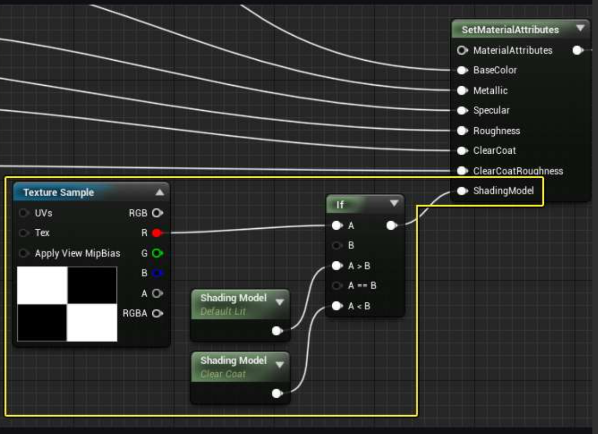

# 蓝图里Material，Material node，Material expression，Material graph，Material property概念解释
这些问题都围绕 **材质编辑器（Material Editor）**，而 UE 里的“材质蓝图”本质上就是一套**节点式编程界面**，和类蓝图（Blueprint Class）是两回事。下面按层级逐个拆开。

## 一、Material 材质

材质是**一种 UE 资产**（`.uasset`），定义物体表面如何响应光照。它决定颜色、粗糙度、金属感、自发光、透明度等最终渲染效果。

它不是“蓝图”，但通过材质编辑器打开后，你看的是一个**可编程的节点图**——这就是常被人叫“材质蓝图”的原因。

## 二、Material Graph 材质图

打开材质资产后看到的整个**节点网络**就叫材质图。

- 由**节点（Node）**和**连接线（Pin 连线）**组成，数据从左往右流动。
- 最右侧的出口是 **材质属性（Material Property）**，比如 Base Color、Metallic、Roughness。
- 节点的计算结果最终都要连接到这些属性上，才能驱动渲染。

你可以把材质图理解为“着色器的可视化脚本”。

## 三、Material Expression 材质表达式

这是最底层的**类概念**，对应引擎里的 `UMaterialExpression` 类。

- 材质图里的每一个节点，背后都对应一个材质表达式实例。
- 比如 `TextureSample` 节点背后就是 `UMaterialExpressionTextureSample`，`Math` 节点背后是 `UMaterialExpressionMultiply` 等。
- 材质编辑器在导入/编译时，会把这个表达式网络翻译成 GPU 着色器代码，最终参与渲染管线。

**简单说：你在图上看到的是“节点”，引擎底层把它们当作“表达式”来编译。**

## 四、Material Node 材质节点

节点就是材质图中的**可视化单元**，每个节点对应一个 Material Expression。

常见节点：
- 采样节点：Texture Sample、Vertex Color
- 数学节点：Add、Multiply、Lerp
- 功能节点：BlendAngleCorrectedNormals、Fresnel
- 引脚（Pin）是节点的输入/输出口，用线连接

节点的作用就是产生、变换或混合数据，最终把结果喂给材质属性。

## 五、Material Property 材质属性

材质属性是材质图的**最终输出**，告诉渲染器这个表面具体用什么数据进行着色。最常用的有：

| 属性 | 作用 | 输入类型 |
|---|---|---|
| Base Color | 基础颜色 | Vector3 (RGB) |
| Metallic | 金属度 | Scalar (0~1) |
| Roughness | 粗糙度 | Scalar (0~1) |
| Normal | 法线 | Vector3 |
| Emissive Color | 自发光 | Vector3 |
| Opacity | 不透明度 | Scalar (透明模式下) |
| Opacity Mask | 遮罩 | Scalar (遮罩模式下) |

**每个属性面板都有对应的输入引脚**，节点网络算好数据后插上去就完成材质定义。

## 六、五者关系一句话总结

材质（Material）包含  
**材质图（Graph）**  
图中的每个 **节点（Node）** 背后是  
**材质表达式（Expression）**  
表达式计算结果流入  
**材质属性（Property）**  
最终驱动渲染。

---

> 补充：如果你想在**类蓝图**（Blueprint Class）里操作材质，看到的其实是“绑定材质到组件”的节点，例如 `Set Material`、`Create Dynamic Material Instance`，那些属于蓝图 API，与上面五个概念不在同一层。

如果你是想深入某一个环节，比如“表达式怎么被编译”或“属性面板参数怎么配”，我可以继续展开。


# property不是每个node都有的吗？只有最后的main 节点才有property吗？还是每个node的输入都是property 
不是每个节点都有 property，**只有 Main Material Node（主材质节点）才有 Material Property（材质属性）**。普通节点的接口叫**输入/输出引脚（Input / Output Pin）**，不叫 property。

为了帮你彻底理清，我们把这两个概念拆开看：

### 一、Material Property 是什么？（专属主材质节点）
**Material Property（材质属性）** 是选中主材质节点后，显示在左侧**细节面板（Details Panel）**里的一系列全局设置。
- **作用**：它决定材质整体的渲染规则（比如怎么和光互动、怎么和背后的像素混合）。
- **常见属性**：混合模式（Blend Mode）、着色模型（Shading Model）、材质域（Material Domain）、物理材质（Physical Material）等。
- **关键点**：这些属性是材质级别的全局开关，**只有主材质节点才有**。

### 二、普通节点的接口叫什么？（引脚 Pin）
普通节点（比如纹理采样、乘法、常数）上面的圆圈接口，官方叫**引脚（Pin）**。
- **输入引脚**：接收数据（比如纹理采样的 UV 输入）。
- **输出引脚**：输出数据（比如算好的颜色、数值）。
- 普通节点**没有** Material Property。

### 三、主材质节点的引脚叫什么？
主材质节点比较特殊，它既有**属性（Property）**，又有**输入引脚（Input Pin）**。
- 它的输入引脚（如 Base Color、Metallic、Roughness）叫**材质输入（Material Inputs）**。
- **联动关系**：当你在细节面板修改了主材质节点的**属性（Property）**时，主材质节点上显示的**输入引脚（Inputs）**会跟着变化。比如把着色模型改成“无光照（Unlit）”，主节点就只剩自发光和不透明度引脚，其他引脚都会消失。

### 总结对比

| 概念 | 所在位置 | 作用 | 举例 |
|---|---|---|---|
| **Material Property**<br>（材质属性） | **只有主材质节点有**<br>（选中后在细节面板看） | 控制材质全局的<br>渲染和混合规则 | 混合模式、着色模型、<br>材质域、物理材质 |
| **Input / Output Pin**<br>（输入/输出引脚） | **所有节点都有** | 节点之间传递数据<br>（连线用的） | 纹理输出的 RGB、<br>乘法的输入 A/B |
| **Material Inputs**<br>（材质输入引脚） | **只有主材质节点有**<br>（节点图上的接口） | 接收最终计算结果<br>用来渲染表面 | Base Color、Metallic、<br>Roughness、Normal |

简单记：**属性（Property）**是全局设置，只看得到主节点有；**引脚（Pin）**是连线用的，大家都有；主节点特有的接收数据的引脚叫**材质输入（Material Inputs）**。

对，你的直觉基本对了，但要分三层看，不然术语会混。

## 一、先给结论

- **广义上**：普通材质表达式在 Details 面板里能改的东西，确实可以叫“属性（property）”。
- **UE 官方术语里**：只有主材质节点 Details 面板里的那批全局设置，才特指叫 **Material Property**。
- **图上的引脚（Pin）不是 property**，引脚是“数据流接口”，property 是“对象字段”。

## 二、三层概念拆开

### 1. Material Property（材质属性）
专指**选中主材质节点时**，Details 面板里那批控制“材质整体怎么渲染”的全局设置：
- Material Domain、Blend Mode、Shading Model
- Physical Material、Usage Flags、Mobile 设置等 

这批是材质级别的，不是某个节点的。

### 2. Material Expression Property（表达式节点属性）
选中**任意普通节点**（TextureSample、Multiply、Custom…）时，Details 面板里显示的是这类：
- `Desc`（节点说明文字）
- 常量默认值（如 Constant 的 R/G/B，Subtract 的 ConstA/ConstB）
- 参数名（Parameter Name，给材质实例用）
- Custom 节点的 Code、Input 数组、Output Type 等 

官方叫 **Material Expression Properties**，不叫 Material Property。  
你可以理解为：“节点自己内部的配置字段”。

### 3. Pin（输入/输出引脚）
图上看得见的圆圈接口：
- 输入引脚（A、B、UVs、Base Color…）
- 输出引脚（RGB、R、G、B、A…）

引脚是**数据流连接点**，不是 property。  
关键区别：

> 引脚没连线时，节点会用 Details 里对应的“默认属性值”顶替；  
> 引脚连了线，就走上游数据，Details 里的默认值失效。

比如 `Subtract` 节点：
- 图上 A、B 是引脚
- Details 里 ConstA、ConstB 是属性（没连线时才用）

## 三、一张对照表

| 东西 | 叫什么 | 在哪 | 例子 |
|---|---|---|---|
| 主节点全局设置 | **Material Property** | 主节点 Details | Blend Mode、Shading Model |
| 普通节点内部配置 | **Expression Property** | 普通节点 Details | ConstA、Parameter Name、Code |
| 节点上的圆圈接口 | **Pin / Input / Output** | 图表上 | A、B、Base Color、RGB |

## 四、一句话纠偏

> ❌ “每个节点的输入引脚都叫 property”  
> ✅ “引脚是 Pin；引脚没接数据时用的默认值，才是节点在 Details 里的 property”

所以你这句话可以改成：

**“普通节点在 Details 里改的也叫 property，只是不是 Material Property，是 Expression 自己的属性；图上的输入口本身叫 Pin，不叫 property。”**

**接下来你更想先了解材质编译时这些节点如何生成 HLSL，还是材质参数如何在材质实例中暴露和覆盖？**

# material property是在选中main material node后在detail面板里显示的内容？material input单指main material node的输入引脚？其他节点的输入就叫input或者PIN?

这几个概念在 UE 材质编辑器里是**三层不同层级**的东西，容易混，拆开说清楚：

## 一、Material Property（材质属性）
- **显示位置**：选中主材质节点（或点击图表空白）后，右侧 **Details 面板**里看到的那一大堆设置项。
- **本质**：是材质的**全局渲染配置**，不是连线用的引脚。
- **典型例子**：Material Domain（材质域）、Blend Mode（混合模式）、Shading Model（着色模型）、Two Sided、Tangent Space Normal 等。
- **作用**：这些属性**决定主材质节点上哪些 Input 引脚被启用/禁用**。比如把 Blend Mode 改成 Translucent，才会冒出 Opacity、Refraction 引脚；选 Clear Coat 着色模型，才会冒出 Clear Coat 相关引脚。

> ⚠️ 常见误区：Details 面板里所有东西 ≠ 输入引脚。面板里很多是"开关/枚举/数值配置"，只有主节点左边那些圆点才叫 input pin。

## 二、Material Input（材质输入）
- **单指**：主材质节点（Main Material Node）上那一组**语义固定的输入槽**。
- **典型例子**：Base Color、Metallic、Roughness、Specular、Normal、Emissive Color、Opacity、ShadingModel……
- **本质**：每个 Input 对应 PBR 渲染管线里的一个**表面属性通道**，是材质图表逻辑的"终点"——所有节点最终把数据喂给这些引脚。
- **没连线会怎样**：未连接的输入会回退到默认值（Metallic=0，Roughness=0.5，Specular=0.5），依然参与计算。

所以**"Material Input"这个词通常专指主材质节点上的输入引脚**，不建议拿去称呼任意节点的输入。

## 三、其他节点上的"输入"叫什么
普通节点（如 TextureSample、If、Multiply、SetMaterialAttributes）上的连接点，通用叫法是：

- **Pin（引脚）**
  - **Input pin**（输入引脚）：接收数据
  - **Output pin**（输出引脚）：吐出数据

比如你之前问的 `SetMaterialAttributes` 上的 `ShadingModel`，严格说是：
- 它是 **SetMaterialAttributes 节点的一个 input pin**
- 这个 pin 承载的数据含义是"材质属性（Material Attribute）里的 Shading Model 字段"

## 四、一张对照表

| 概念 | 所在位置 | 形态 | 例子 |
|---|---|---|---|
| Material Property | Details 面板 | 配置项/下拉框/数值 | Shading Model、Blend Mode |
| Material Input | 仅主材质节点左侧 | 可连线圆点（pin） | Base Color、Roughness |
| Pin / Input pin | 任意节点上 | 可连线圆点 | If 的 A/B 引脚、SetMaterialAttributes 的 ShadingModel |

## 五、回到你图里的情形
- 主材质节点被折叠成 `Material Attributes` 输出节点（因为勾了 Use Material Attributes）
- `SetMaterialAttributes` 里的 `ShadingModel`：**是 pin，不是 Material Property 面板项**；它是把"着色模型"当成一种可打包的材质属性来连
- `Default Lit` / `Clear Coat` 节点：是 **Shading Model 表达式节点**，输出接到上面那个 pin 上

**概念区分已经明确，接下来可以把它落到实际使用上：**

# material property跟material attribute比较
## Material Property vs Material Attribute

这两个词在中文里都直译成“材质属性”，非常容易混淆，但它们在 UE 中是**完全不同层级**的两个概念。

---

### 一句话区分

| | Material Property | Material Attribute |
|---|---|---|
| 中文 | 材质属性（全局配置） | 材质属性（数据包） |
| 本质 | **配置项 / 开关** | **可连线传递的数据** |
| 位置 | 细节面板（Details） | 引脚（Pin）上流动的数据 |
| 是否可连线 | **不可连线** | **可连线** |
| 设置方式 | 下拉框、勾选、数值 | 节点输出驱动 |

---

### 1. Material Property（材质属性·配置层）

- 它是**关于这个材质资产本身的全局配置**，在选中主材质节点（或点击图表空白）时的右侧 **Details 面板**里。
- 它决定的是：**“这个材质应该以什么方式被渲染？”**

典型例子：

- **Material Domain**（材质域）：是 Surface、Masked、Volume？
- **Blend Mode**（混合模式）：Opaque、Masked、Translucent？
- **Shading Model**（着色模型）：Default Lit、Clear Coat、Subsurface？
- **Two Sided**、**Tangent Space Normal**、**Wireframe** 等

**特点**：它们影响整个材质的渲染行为，**不是某个局部引脚的数据**，不能通过节点连线来驱动。比如你不能把 If 节点输出接到“Blend Mode”上。

---

### 2. Material Attribute（材质属性·数据层）

- 它是**材质表面数据流的总称**，即原本主材质节点上那一组输入引脚的**合集**。
- 当你勾选 **Use Material Attributes** 后，主材质节点上那些独立的引脚（Base Color、Metallic、Roughness、Normal、Shading Model 等）**全部被压成一个 pin**，叫做 `MaterialAttributes`。
- 这时，这一整组数据可以通过 `MakeMaterialAttributes` 或 `SetMaterialAttributes` 节点，**像“材料包”一样被组装、传递、修改**。

典型例子：

- Base Color
- Metallic
- Specular
- Roughness
- Normal
- Emissive Color
- Opacity
- Shading Model
- Clear Coat / Clear Coat Roughness

**特点**：这些数据是**动态的、可计算的、可混合的**。比如你可以用 If 节点根据棋盘格纹理，在像素级别动态切换 Shading Model —— 这是 Material Attribute 的核心价值。

---

### 3. 两者的关系（关键）

**Material Property 控制“哪些 Material Attribute 存在且被启用”。**

举个具体例子：

- 在 Details 面板把 **Shading Model 设为 Default Lit** → 主材质节点上就不会出现 Clear Coat 引脚 → `MaterialAttributes` 里也不会有 Clear Coat 数据。
- 把 **Shading Model 设为 From Material Expression** → 主材质节点上才会多出 **ShadingModel** 引脚，`MaterialAttributes` 中才允许 Shading Model 作为 Attribute 被数据连线驱动。

所以同一个“Shading Model”词，在这两层各有一个身份：

- **作为 Property**：细节面板下拉框中选项（Default Lit / Clear Coat / Subsurface…）
- **作为 Attribute**：`SetMaterialAttributes` 节点上的一个 pin，接受表达式节点（Default Lit 节点 / Clear Coat 节点）的输出

---

### 4. 最能帮助理解的类比

| 类比 | Material Property | Material Attribute |
|---|---|---|
| 写代码 | 编译器/编译选项 | 运行时变量 |
| 做菜 | 灶具类型：燃气/电磁（锅子受不受热） | 食材本身：盐、糖的量 |
| 快递 | 派送模式：普通/冷链（决定哪些货能运） | 货物内容本身 |

Material Property 决定渲染管线怎么跑；Material Attribute 决定跑的时候每个表面点拿什么数据。

---

### 5. 回到你的图里

- 黄线框里两个 `ShadingModel` 表达式节点（Default Lit / Clear Coat）输出的，是 **Material Attribute**。
- `SetMaterialAttributes` 节点接收、打包它们的，也是 **Material Attribute**。
- 而主材质节点上必须先在 Details 面板把 Shading Model 这个 **Material Property** 设为 **From Material Expression**，这个 Attribute 才能被识别并生效。

**简而言之：Material Property 是全局开关，Material Attribute 是经由引脚传输的数据流。**

# UE里不同的节点
UE 节点体系
├─ 逻辑/行为
│  ├─ Blueprint（通用脚本）
│  ├─ Anim Blueprint（动画状态）
│  ├─ Behavior Tree（AI）
│  └─ Verse（文本语言）
├─ 渲染/视觉
│  ├─ Material（表面）
│  ├─ Material Function
│  ├─ Post Process
│  ├─ Niagara（粒子）
│  └─ Control Rig（绑定）
├─ 时间/音频/内容
│  ├─ Sequencer（过场）
│  ├─ Sound Cue / MetaSounds
│  ├─ PCG（程序化生成）
│  └─ Landscape Graph
└─ 工具链
   ├─ Editor Utility Blueprint
   └─ Render Graph / Global Shader（C++ 层）


# UE5中材质的input，pin，Material property，普通节点，material expression，input，output比较
先给一张“包含关系图”，再逐个拆：

```
Material（资产）
└─ Material Graph（节点图，DAG）
   ├─ Material Expression（节点对象的底层类）
   │  ├─ Input Pin（输入引脚，如 A / B / UVs）
   │  └─ Output Pin（输出引脚，如 RGB / R / G / B / A）
   ├─ Material Function 节点（封装好的一组 Expression）
   ├─ Parameter 节点（Scalar/Vector/Texture 参数）
   └─ Main Material Node（主材质节点，特殊节点）
      └─ Material Property / Material Input（Base Color、Metallic…）
```

一句话总纲：**Expression 是“算东西的节点”，Pin 是“节点上的接口”，Material Property 是“主节点上最终要填的槽”**。下面分开讲。

---

## 1. Material Expression（材质表达式）

UE5 材质图里**几乎所有你拖出来的节点**都是 Expression，底层都继承自 `UMaterialExpression`。

- 每个 Expression = 一小段 HLSL 代码块，或者一个固定值
- 常见例子：`Constant`、`Multiply`、`Add`、`TextureSample`、`Lerp`、`Clamp`、`Panner`、`Custom`
- 特点：
  - 有 **Input Pin**（接收上游数据）
  - 有 **Output Pin**（把计算结果送出去）
  - 本身不关心“最终渲成什么”，只管算这一小步 

> 类比：Expression 就像着色器里的“一行运算”或“一个函数调用”。

---

## 2. Pin（引脚）

Pin 不是独立概念，是 **Expression 节点上的连接点**。

| 类型 | 作用 | 例子 |
|---|---|---|
| **Input Pin** | 接收别的节点输出 | `Multiply` 的 A、B；`TextureSample` 的 UVs |
| **Output Pin** | 把结果送出去 | `TextureSample` 的 RGB、R、G、B、A |
| **Exec Pin** | 控制流（少数表达式用） | If、循环类节点 |

要点：
- 一个输出 Pin 可以连多个输入 Pin
- 一个输入 Pin 只能接一个输出（后接的覆盖前面的）
- 空着不连 ≠ 没值，很多节点有内部默认值 

> Pin 只是“接口”，不是数据本身，也不是最终材质属性。

---

## 3. Material Property / Material Input（材质属性 / 主节点输入槽）

这是 **Main Material Node（最右边那个大节点）** 上的那些槽位：

- Base Color
- Metallic
- Roughness
- Specular
- Emissive Color
- Normal
- World Position Offset
- Opacity / Opacity Mask
- Ambient Occlusion
- Refraction
- Clear Coat 等

底层对应 `EMaterialProperty` 枚举（`MP_BaseColor`、`MP_Normal`…）。

关键理解：
- 它们是**最终输出目标**，不是普通节点
- 你前面算了一堆 Expression，最后必须“连到这些槽”才会生效
- 没连线的槽走默认值（Metallic=0，Specular=0.5，Roughness=0.5）
- 哪些槽亮着，由 `Material Domain / Blend Mode / Shading Model` 决定
  - 比如 Translucent 才出现 Opacity，Masked 才出现 Opacity Mask
  - 关掉的槽即使还连着节点，编译时也会被忽略 

> 类比：Property 是“着色器最终要写的 G-Buffer / 输出变量”。

---

## 4. 普通节点（General / 普通 Expression）

“普通节点”不是官方术语，是相对下面几种特殊节点来说的：

| 类别 | 说明 | 例子 |
|---|---|---|
| **普通 Expression** | 做运算或取数据 | Multiply、Lerp、Clamp、Frac |
| **参数节点 Parameter** | 值可暴露给材质实例动态改 | ScalarParameter、VectorParameter、TextureSampleParameter |
| **输入数据节点 Input Data** | 从渲染管线读内置数据，不可改 | AbsoluteWorldPosition、PixelNormalWS、CameraPosition |
| **材质函数 Material Function** | 一组 Expression 打包成的可复用资产 | Fresnel、Blur、FlattenNormal |
| **主材质节点 Main Node** | 特殊节点，收所有属性槽 | 最右边那个 |

普通节点和参数节点的区别：参数节点多一个“参数名”，同名参数在材质实例里会被当成同一个量批量改 。

---

## 5. Input 节点 vs Output 节点（容易混）

这里“Input/Output”有两层意思，别搞混：

### ① 引脚层面（Pin 的 in/out）
- 任何 Expression 都有
- 比如 `Multiply`：输入 A/B，输出 Result

### ② 材质函数里的 Function Input / Output 节点
- 只在 **Material Function** 编辑器里用
- `FunctionInput`：函数被调用时从外部接收参数
- `FunctionOutput`：把结果返回给调用方
- 对应 `UMaterialExpressionFunctionInput` 

### ③ 主材质节点的 Input（Material Input）
- 就是上面第 3 节说的 Property 槽
- 它是“整个材质的最终输入”，不是某个小节点的输入

---

## 6. Material Attributes 模式（进阶）

当主节点勾了 **Use Material Attributes** 时，情况变一下：

- 普通模式：Base Color / Normal / Roughness 各自是独立 Pin
- Attributes 模式：这些属性被打成一个 `FMaterialAttributesInput` 包
- 用 `SetMaterialAttributes` / `GetMaterialAttributes` 节点拆包、改某一项、再打包
- 好处：做 Layered Material、多层混合时图更干净 

---

## 7. 一张对照表收尾

| 概念 | 本质 | 在图里的位置 | 是否生成 HLSL |
|---|---|---|---|
| Material Expression | 节点对象（基类） | 图中各处 | 是（一小段） |
| Pin | 节点的输入输出接口 | 节点边缘 | 否（只是连线点） |
| Material Property / Input | 主节点上的最终槽位 | 只在 Main Node 上 | 是（输出目标） |
| 普通节点 | 运算型 Expression | 图中 | 是 |
| 参数节点 | 可暴露的 Expression | 图中 | 是 |
| Material Function | 封装好的 Expression 组合资产 | 图中（作为一个节点） | 展开后生成 |
| Function Input/Output | 函数内部边界节点 | 仅在 Function 图里 | 否（桥接） |

---

## 8. 三个最常见误区

1. **“Base Color 是个节点”**  
   错。Base Color 是主材质节点的一个 Input 槽，前面必须靠 Expression 算出来再连进去。

2. **“没连线的槽就是 0”**  
   不一定。Metallic 默认 0，Specular 默认 0.5，Roughness 默认 0.5，各有默认值。

3. **“连了就行”**  
   如果当前 Blend Mode / Shading Model 没开启那个 Property（比如 Opaque 下连了 Opacity），连线会被直接忽略，编译不报错但没效果。

---

**概念关系已经理清，接下来可以选一个实用方向继续深入：**